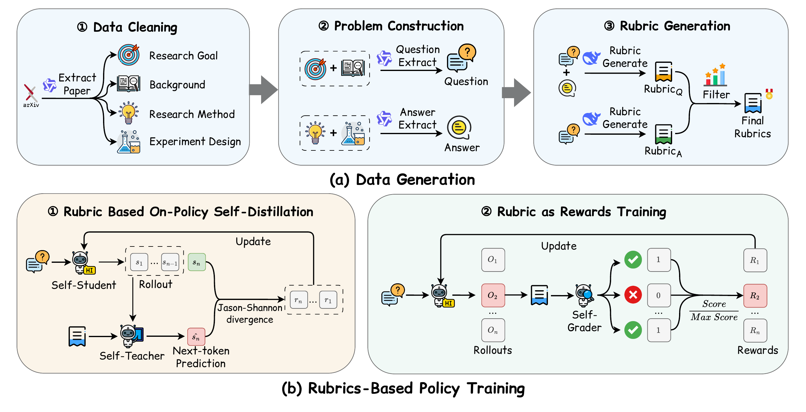
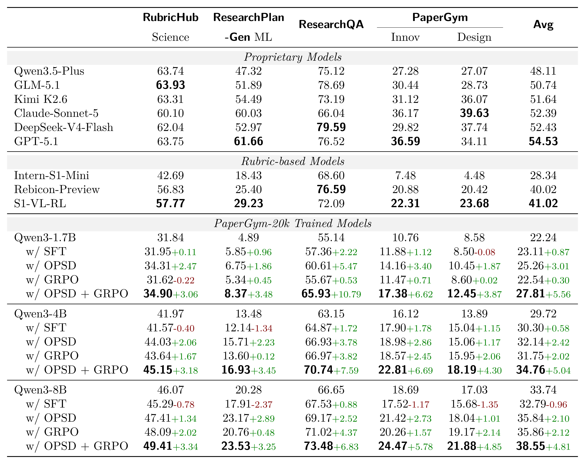
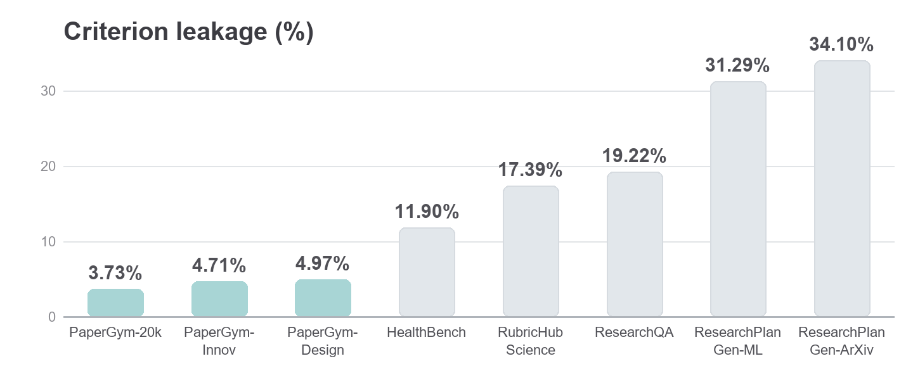

# PaperGym: Rubric-Centered Evolution for Research-Plan Generation

<div align="center">

[](https://zju-real.github.io/PaperGym)
[](https://huggingface.co/CabbageWyh/PaperGym-Model)
[](https://huggingface.co/datasets/CabbageWyh/PaperGym-Data)

*Yuhan Wang · Zhengxi Lu · Yuchen Yan · Kaitao Song · Wenqi Zhang · Weiming Lu · Jun Xiao · Yueting Zhuang · Yongliang Shen*

</div>

## 🔥 Overview

PaperGym couples a **data-generation** pipeline that turns each paper into a low-leakage training environment with a **two-stage training** scheme that uses the extracted rubrics twice: first as privileged context for a rubric-conditioned self-distillation teacher, then as the reward for GRPO — a *teach–explore* paradigm. Our highlights are listed below,

- **3.7%** criterion leakage — roughly **3–9× lower** than existing rubric-based benchmarks (12%–34%).
- **20,000** instances in **PaperGym-20k** across five domains, with held-out **PaperGym-Innov / PaperGym-Design** test sets.
- **+5.6 / +5.0 / +4.8** average gains over base models across five benchmarks for Qwen3-1.7B / 4B / 8B — beating SFT, either training stage alone, and the reversed ordering.
- **73.48** on ResearchQA with fine-tuned Qwen3-8B, surpassing the much larger Kimi K2.6 (73.19).
- **58.1%** win rate in three-way blind comparisons on ResearchPlanGen-ML, vs. 28.2% for a RubricHub-trained baseline.

<p align="center">
  
</p>

## 📦 Released Resources

| Type | Description | Link |
|:---|:---|:---|
| **Model** | Fine-tuned models (produced via OPSD / GRPO training) | [CabbageWyh/PaperGym-Model](https://huggingface.co/CabbageWyh/PaperGym-Model) |
| **Corpus & Benchmarks** | **PaperGym-20k** (20,000 instances) with held-out test sets **PaperGym-Innov** / **PaperGym-Design** | [CabbageWyh/PaperGym-Data](https://huggingface.co/datasets/CabbageWyh/PaperGym-Data) |
| **Code** | Complete pipeline: data generation, OPSD / GRPO training, and the evaluation suite (this repository) | This repository |
| **PaperGym-Innov**  | Benchmark for Methodological innovation | `test/PaperGym/data/innov.parquet`  |
| **PaperGym-Design** | Benchmark for Experimental design       | `test/PaperGym/data/design.parquet` |


## 📢 News

- **`2026-08-29`**: Released the PaperGym pipeline, the **PaperGym-20k** corpus, the **PaperGym-Innov / PaperGym-Design** benchmarks, and the fine-tuned models on [Hugging Face](https://huggingface.co/CabbageWyh/PaperGym-Model). *(arXiv link will be added upon release.)*

## 📊 Results

<p align="center">
  
</p>

<p align="center">
  
</p>

See the [project page](https://zju-real.github.io/PaperGym) for the paper and complete experiments, ablations, and analysis.

## 🗂️ Repository Structure

```
PaperGym/
├── data_generation/          # Build the corpus from arXiv papers
│   ├── get_paper.py          #   batch-download paper TeX sources
│   ├── query_category.py     #   query arXiv categories via API
│   ├── process_paper/        #   merge / extract / section the LaTeX
│   └── problem_generation/   #   synthesize questions, answers, rubrics
├── opsd/                     # Stage 1 · rubric-conditioned OPSD (TRL)
│   ├── sft_train.py · opsd_train*.py
│   ├── opsd_trainer*.py      #   JSD loss, vLLM sync, EMA / fixed teacher
│   ├── data_collator*.py     #   student–teacher input pairs
│   └── scripts/              #   1B / 4B / 8B launch scripts
├── grpo/                     # Stage 2 · GRPO with rubric-as-reward (verl)
│   ├── reward_fn/            #   offline rubric scoring functions
│   ├── scripts/              #   training launch script
│   └── data/                 #   train / val sets (Parquet)
├── docs/                     # Project page (deploy via GitHub Pages)
│   ├── index.html            #   project homepage
│   └── images/               #   page figures
└── test/                     # Evaluation & analysis
    ├── PaperGym/             #   in-domain Innov / Design evaluation
    ├── ResearchQA/ · ResearchPlanGen/ · RubricHub/   # external benchmarks
    ├── compare/              #   blind two- / three-way win-rate comparison
    ├── data_leakage/         #   criterion-leakage detection
    ├── entropy/              #   response uncertainty (Shannon entropy)
    ├── rubric_rate/          #   Method vs. Experiment rubric analysis
    └── stability/            #   scorer-consistency analysis
```

## 🚀 Quick Start

Model, dataset, and API paths are placeholders in the launch scripts — replace them per your environment before running. Configure scoring APIs via `.env` (see [`.env.example`](.env.example)).

```bash
# 1. (Optional) build data from arXiv papers
python data_generation/get_paper.py
python data_generation/problem_generation/solve_dataset.py

# 2. Stage 1 — rubric-conditioned OPSD
bash opsd/scripts/run_opsd_8b.sh

# 3. Stage 2 — GRPO with rubric-as-reward
bash grpo/scripts/grpo_1b_offline.sh
```

See [opsd/README.md](opsd/README.md) and the per-module READMEs under `test/` for detailed instructions.

## 🧪 Evaluation

All benchmarks follow the same two-step workflow — **generate → score**. Model, dataset, and API paths are configurable variables in each script; replace the placeholders for your environment (remote API keys also come from `.env`, see [`.env.example`](.env.example)).

### 1 · Generate answers

Each benchmark's `run_generate_*` scripts start a **local vLLM** service (`.sh` without `_remote`) or call a **remote OpenAI-compatible API** (`*_remote.sh`), producing answer JSON files under `answer/<benchmark>/`.

```bash
bash test/PaperGym/run_generate_innov.sh                # in-domain Innov (local vLLM)
bash test/ResearchQA/run_generate_responses_remote.sh   # ResearchQA (remote API)
bash test/ResearchPlanGen/run_rubric_eval_remote.sh     # ResearchPlanGen-ML
bash test/RubricHub/run_generate_responses.sh           # RubricHub Science
```

### 2 · Score against rubrics

A judge model grades each generated response criterion-by-criterion. Configure the judge via `SCORE_BASE_URL` / `SCORE_API_KEY` / `SCORE_MODEL` in the script.

```bash
bash test/PaperGym/run_score.sh innov design     # in-domain scoring
bash test/ResearchQA/run_compute_coverage.sh     # ResearchQA coverage scoring
bash test/RubricHub/run_score_responses_batch.sh # batch rubric scoring
```

Analysis scripts (blind win-rate comparison, leakage detection, entropy, stability, rubric composition) live under `test/` — see the code and the per-module READMEs (`test/*/README_EN.md`, `test/*/README_ZH.md`).


## ⭐ Citation

If you find PaperGym useful in your research, please consider citing:

```bibtex
@misc{wang2026papergym,
  title   = {PaperGym: Rubric-Centered Evolution for Research-Plan Generation},
  author  = {Yuhan Wang and Zhengxi Lu and Yuchen Yan and Kaitao Song and
             Wenqi Zhang and Weiming Lu and Jun Xiao and Yueting Zhuang and
             Yongliang Shen},
  year    = {2026},
  url     = {https://zju-real.github.io/PaperGym/},
  note    = {arXiv ID to be added}
}
```

## 🤝 Acknowledgements

This project builds on [verl](https://github.com/verl-project/verl), [vLLM](https://github.com/vllm-project/vllm), and [TRL](https://github.com/huggingface/trl). We thank the authors of these projects for their open-source contributions.
